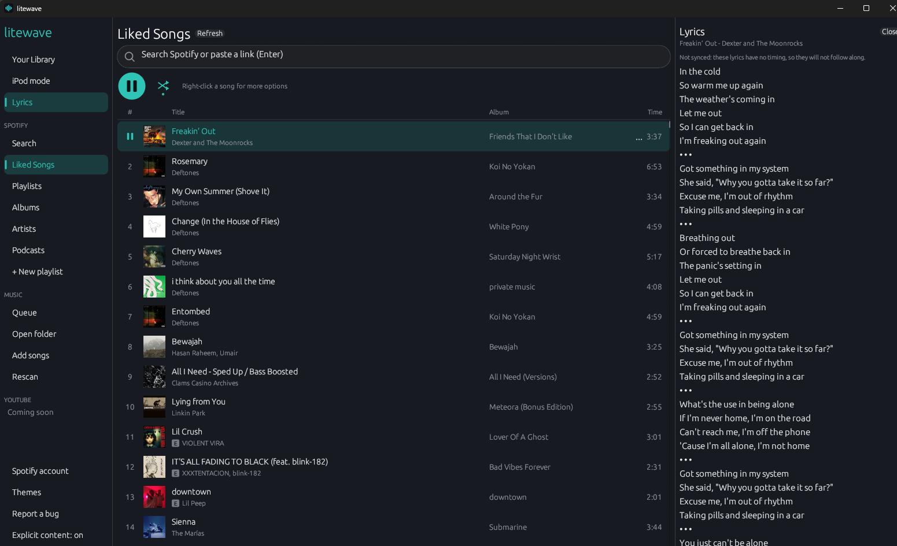
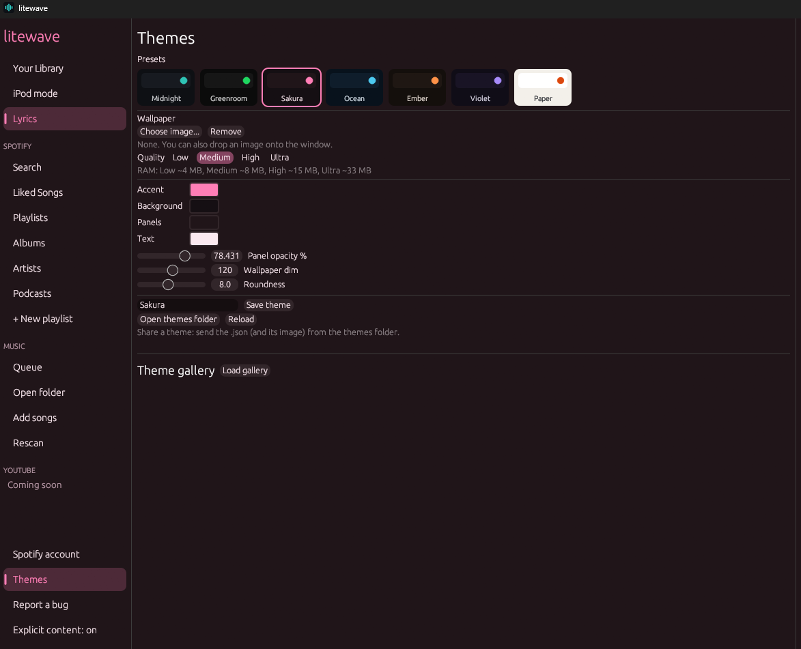

# litewave

A tiny, fast, native music player for your PC (Windows and Linux, desktop only). Rust + [egui](https://github.com/emilk/egui) + [rodio](https://github.com/RustAudio/rodio). No browser engine, no web view.



## Download

Get the latest build from the [Releases page](https://github.com/q4uincy/litewave/releases): **Windows** (`.zip`) and **Linux** (`.tar.gz`). Unzip and run `litewave`.

**Mac: build from source** (see below). There is no signed Mac app yet.

**Phones:** there is no Android or iPhone app yet. You can still control litewave from your phone: open Spotify on the phone and pick the device called "litewave".

## Features

- Plays local files (mp3, flac, ogg, wav, m4a, aac), fast folder scan, instant search
- **Themes** with a built-in gallery: presets, your own colors, a wallpaper behind the whole app
- **Queue**: hover a song, press `...`, pick *Play next* or *Add to queue*
- **iPod mode**: LCD menus and a click wheel you can drag, scroll or click
- **Shuffle** and **Smart shuffle** (never the same artist twice in a row), repeat, sleep timer
- **Lyrics**: synced from `.lrc` files or the free [LRCLIB](https://lrclib.net) service
- **Media keys**: play / pause / next / previous keys and the system media overlay
- **Spotify (optional, unofficial)**: your playlists, Liked Songs, albums, artists, podcasts, search, and playback. litewave also shows up as a Spotify Connect device called "litewave"



## Spotify: please read

- The Spotify part is **unofficial**. It uses [librespot](https://github.com/librespot-org/librespot), the way other open-source players do. Spotify can change or block it at any time.
- **Spotify needs a Premium account.** Since February 2026 Spotify only lets Premium accounts create the developer app litewave uses, and playback needs Premium too. Without Premium you can still use litewave for your own music files.
- litewave is not made by or connected to Spotify.
- You create your own Spotify developer app (with a Premium account) and paste its Client ID. Spotify allows one developer app per person and up to 5 users per app. This is a one-time step: [step-by-step guide with pictures](https://q4uincy.github.io/litewave/setup-guide.html).

## Build from source

Requires a stable [Rust toolchain](https://rustup.rs).

```sh
# Linux: build tools (libssl-dev is needed for Spotify)
sudo apt install pkg-config libasound2-dev libssl-dev

cargo run --release                                  # local player + iPod mode
cargo run --release --features spotify               # plus Spotify
cargo run --release --features spotify,mediakeys     # plus media keys (what the downloads use)
```

## Themes

Open **Themes** in the sidebar. Pick a preset, tweak the accent/background/panel/text colors, set panel opacity, wallpaper dim and roundness, and choose a wallpaper image (png, jpg, webp). You can also drop an image onto the window to use it as the wallpaper.

**Save theme** writes `<name>.json` (and copies the wallpaper next to it) to the themes folder (**Open themes folder** in the window). To share a theme, send those two files; to install one, drop the `.json` onto the window or copy both files into the themes folder and press **Reload**.

```json
{
  "name": "Sakura Night",
  "author": "you",
  "bg": "#150f13",
  "panel": "#201519",
  "text": "#fbe9f0",
  "subtext": "#b99aa8",
  "accent": "#ff7eb6",
  "panel_alpha": 190,
  "dim": 130,
  "rounding": 10,
  "background": "sakura-night.jpg"
}
```

Extra BetterDiscord-style fields (all optional): `accent2` (links and glow color), `border` (dividers), `tint` (color laid over the wallpaper, strength = `dim`), `blur` (0-12, frosted wallpaper) and `glow` (0-255, soft `accent2` glow from the bottom edge).

Every field is optional. Wallpapers are downscaled to at most 1280x720 when loaded (about 4 MB of RAM) and only still images are supported, which keeps memory use low.

## iPod mode

Click **iPod mode** in the sidebar. The window shrinks to just the iPod (borderless, draggable by the strip on top) with **Minimize**, **Full view** (back to the normal window) and **Close** buttons. Settings > Skin switches between Silver (Y2K), Black, Classic and Pink bodies. Settings > Wallpaper picks a menu wallpaper for the dark skins (built-in Stardust, or **Add wallpaper...** for your own images, kept in `litewave/wallpapers` in your config folder), and Wallpaper dim keeps the text readable. Now Playing shows the song's cover.

| Input | Action |
|---|---|
| Drag around the wheel / mouse scroll / Up, Down | Move selection (adjusts volume on Now Playing) |
| Wheel center / Enter | Select |
| MENU zone / Esc / Backspace | Back |
| Wheel right / left zones, Right / Left | Next / previous |
| Wheel bottom zone / Space | Play / pause |

## Lyrics

Lyrics lookups are on by default (**Settings > Lyrics** in iPod mode). In the main window the lyrics panel is closed until you click the lyrics button (the little lines icon next to the volume bar, or **Lyrics** in the sidebar).

1. A `.lrc` file with the same name next to the song wins (`song.mp3` + `song.lrc`).
2. Otherwise litewave asks LRCLIB with the song's title, artist, album and length. Results are cached in `litewave/lyrics` in your config folder, so each song is looked up once. "Not found" is retried after a week.
3. Synced lyrics show the previous, current and next line on the iPod screen. The main window shows the whole song in a side panel and scrolls along; click a line to jump to it. In a narrow window (under 760 px) the lyrics replace the song list instead. Lyrics without timing are shown in the side panel only.

Lookups send only the song's title, artist, album and length. Turn lyrics off to stop all lookups.

## Spotify (experimental)

Spotify support is a build feature. Spotify needs your own Spotify developer app and a Premium account (see the guide above).

### Setup

1. Build with `--features spotify`.
2. Create an app on the [Spotify developer dashboard](https://developer.spotify.com/dashboard):
   - Add this Redirect URI exactly: `http://127.0.0.1:8898/login`
   - Tick **Web API**.
   - Copy the app's **Client ID** (32 characters).
   - If the app is in Development Mode, add your own Spotify account under **User Management**.
3. In litewave open **Connect Spotify** in the sidebar, paste the Client ID, and click **Sign in with Spotify**. Wait a few seconds: a new browser tab opens by itself to connect Spotify. When it says "litewave is connected", close it.
4. Approve in the browser **twice**: once for browsing (your app), once for playback (librespot).
5. Browse Liked Songs, Playlists, Albums, Artists and Podcasts in the sidebar.
6. **Search**: type in the box at the top of the Spotify view (or click Search in the sidebar) and press Enter. You get songs, artists, albums, playlists and podcasts. Pasting a Spotify playlist, album, artist or podcast link opens it instead.
7. **Podcasts**: your saved podcasts are under Podcasts; open one to play its newest episodes (up to 300).

### Explicit content

Like Spotify's own setting: **Explicit content** (bottom of the sidebar, the Spotify window, or iPod Settings). Songs Spotify marks explicit show an **E** badge. With the setting off they are greyed out, will not play when clicked, and are skipped by next and shuffle. Local files carry no such flag, so they are never blocked.

### Editing playlists and your library

- **+ New playlist** in the sidebar creates a private playlist.
- Right-click a song: **Add to playlist** (any playlist you own or collaborate on), **Save to Liked Songs**, or **Remove from this playlist**. In Liked Songs it offers **Remove from Liked Songs**.
- On a playlist you own, **Rename** and **Delete** sit next to the title. Right-click an album, artist, playlist or podcast row to **Save / Follow** or **Remove / Unfollow**; the **Save** / **Follow** button on a page does the same.
- Editing needs extra permissions. If you connected with an older version, open **Spotify account** and sign in again once. Spotify only lets you edit playlists you own or collaborate on, and caps search at 10 results per kind for apps in development mode.

### Why you need your own Client ID

Spotify rate-limits Web API requests made with the client ID that librespot uses, often from the very first request, which shows up as `Spotify API error 429`. Your own app has its own request quota. Playback still signs in through librespot, which Spotify accepts for streaming. If you leave the Client ID empty, litewave falls back to the shared sign-in, and browsing will usually be rate-limited.

### Things to know

- Playback needs Spotify Premium (so does creating the developer app) and uses [librespot](https://github.com/librespot-org/librespot).
- Unofficial: playback signs in the way other open-source players do, so Spotify can change or block it at any time.
- Private playlists and some playlists made by Spotify cannot be read through the Web API.
- If a track will not play, **Spotify account > Advanced** shows the last librespot messages and has an **Open log folder** button (`librespot.log`).
- Refresh tokens are stored in plain text in your config directory (`litewave/config.json`). Use **Sign out** to remove them. Never share that file.
- The litewave volume slider controls Spotify too, and your phone can change it as well.

### Troubleshooting

| Problem | Fix |
|---|---|
| Browser says `INVALID_CLIENT: Invalid redirect URI` | The Redirect URI in your dashboard must match exactly: `http://127.0.0.1:8898/login` |
| "Port 8898 is busy" | Finish or close the pending login tab, then try again |
| `Spotify API error 429` | Add your own Client ID, wait a minute, then press Refresh |
| Playback says sign in again | Open **Spotify account** and sign in again to renew it |

## Layout

```
src/
  main.rs        window setup
  app.rs         classic UI, queue logic, Spotify connect flow
  app/ipod.rs    iPod menus and click wheel
  player.rs      rodio player + router between local and Spotify playback
  library.rs     background folder scan + tag reading
  lyrics.rs      .lrc parser, LRCLIB lookup, on-disk cache
  config.rs      JSON settings in the OS config directory
  spotify/       Web API client (your own Client ID), PKCE login, librespot engine (feature-gated)
```

## Roadmap

Planned, in no particular order:

- [ ] Home page and one search box for library / Spotify
- [ ] Phone Next / Previous and queue through Spotify Connect
- [ ] More themes and more iPod skins
- [ ] Local playlists, including saving a Spotify song into your own list
- [ ] Equalizer and crossfade
- [ ] Gapless playback
- [ ] YouTube search and playback (it needs more work before it is reliable)
- [ ] Signed macOS app
- [ ] Android app (`.apk`). An idea only, with no date: it needs a lot of work (file access, background audio, media controls, and a simpler Spotify sign-in)
